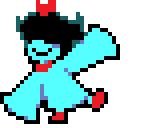
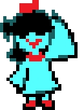

# AQUA-pet

<p align="center">
  
  &nbsp;&nbsp;&nbsp;&nbsp;
  
</p>

将《Deltarune Chapter 5》中的人气角色 AQUA 做成桌宠。

> **开发状态**：项目仍处于早期开发阶段，功能尚不完善，目前仅支持 Windows 11（x86_64）。

## 简介

AQUA 是无边框的桌面角色，会显示在普通应用窗口上方。它把屏幕底部和窗口上沿当作地面，会在上面走动、坐下或跳下，也可以用鼠标拖动到任意位置。

- 只有鼠标主动靠近 AQUA 时，它才会挥手。待机时会随机挥袖、鼓掌或转圈。
- 拖动停稳后松手，AQUA 会垂直落下，落地后播放一轮「鼓掌原地跳 · 咖啡馆换装」，然后恢复默认晃动。
- 拖动中甩手，AQUA 会沿抛物线飞到途中碰到的第一个窗口上沿或屏幕底部。它落地时会倒下，滑一小段，停稳一秒后恢复默认晃动。
- 左键单击 AQUA 会播放一次「ACT 恭维」，最后一帧停留 500 毫秒后恢复默认晃动。
- 播放音乐时，待机会换成舞步。
- AQUA 可以跳到屏幕上仍露出的窗口上沿。跨窗起跳前会朝落点歪头一秒，横向和高低差都不限。向上或同高跳时，移动速度提高到原来的 1.5 倍，翻滚动画按原速播放，长跳时会循环播放。向下跳时会先跃起，再用原来的下落姿势落地。
- 右键点击角色或托盘图标，可以打开桌宠设置和 Debug 动作预览。

## 如何构建

从源码构建需要 **Rust MSVC 工具链**和 **Visual Studio C++ Build Tools**。

```powershell
git clone https://github.com/peixuanthomas/aqua-pet.git
cd aqua-pet
cargo build --release
```

构建完成后，运行 `target/release/aqua-pet.exe` 即可显示桌宠。

## 著作权

本项目使用的游戏图片素材来自《Deltarune Chapter 5》，著作权归原权利人所有。项目仅使用游戏素材，**不包含游戏本体**。
