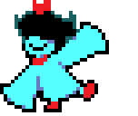
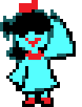

# AQUA-pet

<p align="center">
  
  &nbsp;&nbsp;&nbsp;&nbsp;
  
</p>

将《Deltarune Chapter 5》中的人气角色 AQUA 做成桌宠。

> **开发状态**：项目仍处于早期开发阶段，功能尚不完善，目前仅支持 Windows 11（x86_64）。

## 如何使用

从源码构建需要 **Rust MSVC 工具链**和 **Visual Studio C++ Build Tools**。测试环境使用 Rust 1.98，项目采用 Rust 2024 edition。

克隆项目后，依次执行检查、测试和构建：

```powershell
git clone https://github.com/peixuanthomas/aqua-pet.git
cd aqua-pet
cargo fmt --check
cargo test
cargo clippy --all-targets -- -D warnings
cargo build --release
```

构建完成后，运行 `target/release/aqua-pet.exe`，即可显示无边框的桌宠角色。

- **左键拖动**：将角色移动到屏幕上的任意位置。
- **右键菜单**：打开桌宠设置或 Debug 动作预览面板。
- **桌宠设置**：游戏菜单风格的黑底白框界面，可调整随机走动概率和距离倾向；青色数值随滑块更新，支持 Tab 和方向键，修改自动保存。
- **Debug 动作预览**：同样使用游戏菜单风格，左侧搜索和筛选动作，紫色标出当前选择；右侧显示动作名称、大幅预览、时间轴和动作详情，支持暂停、重播、逐帧、播放速度、桌宠大小及背景切换。

设置保存在 `%LOCALAPPDATA%\AquaPet\settings.json`。

启动时添加 `--debug` 参数（`aqua-pet.exe --debug`），可直接打开 Debug 动作预览面板。

## 项目还原

项目从游戏本体中提取了 **131 个原作动作片段**，包括 **106 个角色预设**和 **25 个组合／攻击预设**。

素材保留了原始的透明画布、尺寸和对齐原点，因此部分图片可能因原作中的位置设置而出现偏移。项目还通过反编译游戏程序，获取原作的动画播放速度和角色行走速度，尽量还原游戏中的表现。

## 著作权

本项目使用的游戏图片素材来自《Deltarune Chapter 5》，著作权归原权利人所有。项目仅使用游戏素材，**不包含游戏本体**。
